# Sinking Funds

A personal finance app for planning each paycheck: how much to set aside for savings goals ("sinking funds"), where the rest of the paycheck goes, and whether the money set aside for credit cards covers what's owed. Flask + SQLite backend, React frontend, runs locally.

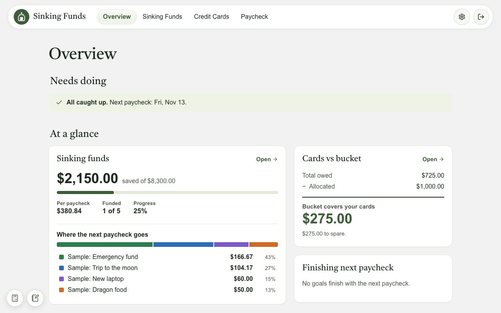

*Screenshots use the built-in fake sample data.*

## Features

### Overview
The home page. **Needs doing** lists anything that needs action, such as a paycheck to log, goals that need recalculating, money to move into the credit card bucket, or goals coming due. **At a glance** shows total savings progress, where the next paycheck goes (split by goal), whether the bucket covers your cards, and which goals the next paycheck finishes. At the bottom you can **download a copy** of your data: everything as JSON, or your goals as a CSV spreadsheet.

### Sinking Funds
Every goal in one list, with progress, the amount to save per paycheck, the due date, and how many paychecks are left. Drag rows to reorder them.

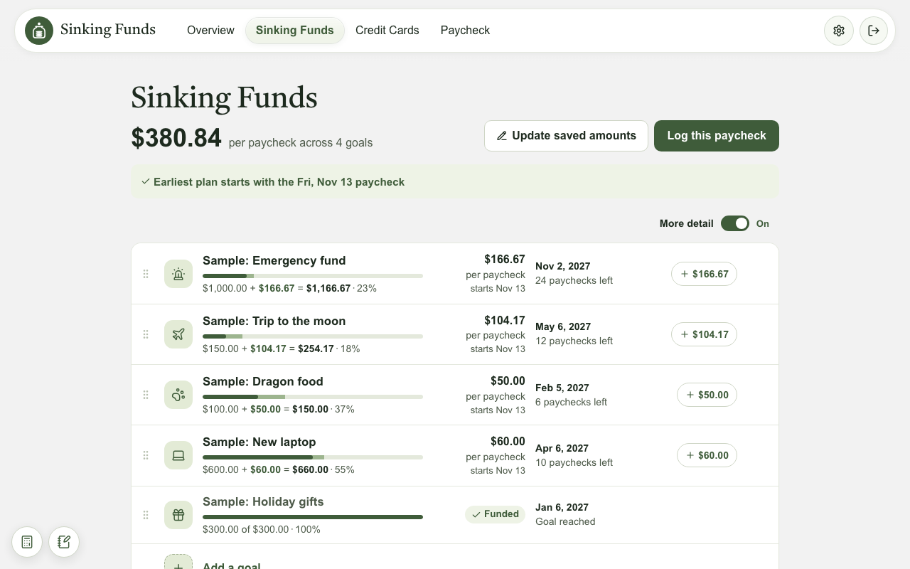

- **Log this paycheck** adds each goal's planned amount in one step. Untick a goal or change an amount first if needed. You can undo afterwards, and a goal that becomes fully funded gets confetti.
- **Update saved amounts** lets you edit every goal's balance at once, for example to match your bank.
- **More detail** shows each goal's balance after the next paycheck and the date its plan starts.
- The **status bar** says which paycheck the plans start from. Hover it to **Recalculate** from the last paycheck, the next one, or any date.

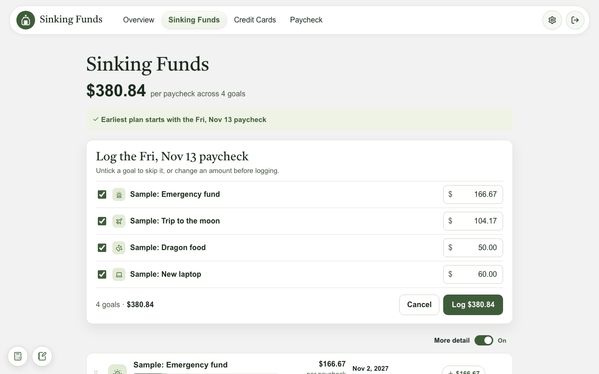

### A goal
Click a goal to edit its amount saved, goal amount and due date, see its **Plan by paycheck** (each payday's contribution and the running total), and log a single paycheck.

**Spend from Fund** records money taken out when the goal is used (the trip happened, the bill got paid). By default it also lowers the goal by the same amount. Each spend is listed under **Spending**, and removing an entry puts the money back.

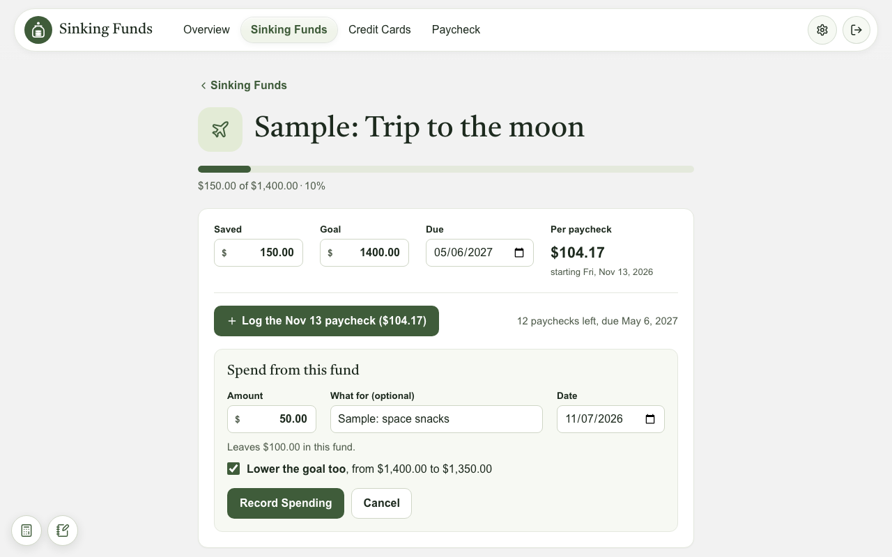

### Paycheck
Your paycheck from top to bottom: Gross Pay, then Pre-Tax (retirement and other contributions), Taxes, Post-Tax, and your budget categories. **This Paycheck** on the right does the math down to **Leftover**. The page is locked by default so the numbers can't be changed by accident. Click the lock icon to edit.

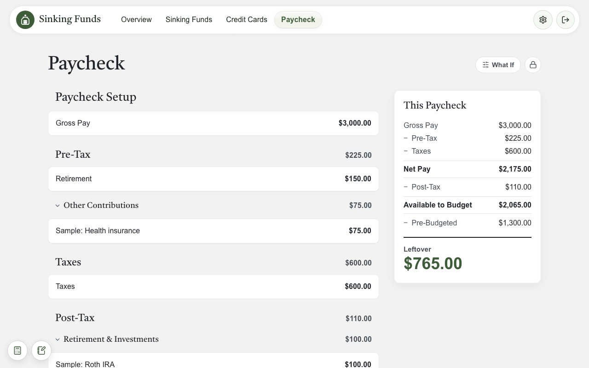

**What If** lets you try different numbers without saving them, such as a raise, a new retirement amount, or taxes from the ADP paycheck calculator. It compares Now with What If and shows the change per paycheck and per year. You can then save the new Gross Pay, Retirement or Taxes if you want.

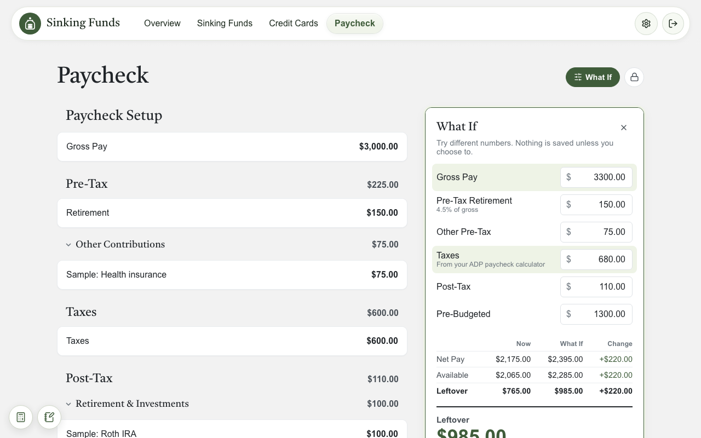

### Contributions
Plan how much to put in each paycheck to reach a yearly maximum, such as a 401k or Roth IRA. Add an account with its yearly maximum, enter what you've contributed so far and as of which paycheck (or **Start of year**, if nothing has gone in yet, so all 24 paychecks count), and choose the paycheck to reach the maximum by (the last one of the year by default). The **slider** picks how many of the remaining paychecks to contribute from, starting with the next one, and the amount per paycheck follows. You can also type an amount, or a percent with each account's **$ / %** switch: of gross pay for pre-tax accounts, and of net pay for post-tax ones like a Roth IRA. The note under the amount shows both percents. The lock icon makes the page read-only until you unlock it. **Split into periods** (up to three) gives different back-to-back stretches of paychecks different amounts, for example the last two at your employer match minimum and the rest spread over the earlier ones. Leave one amount empty and it takes whatever is left. **Paycheck by paycheck** shows each contribution and the running total. The arrow beside an account's name minimizes it to a one-line summary. **Apply to Paycheck…** copies the amount into your Paycheck page after showing what will change.

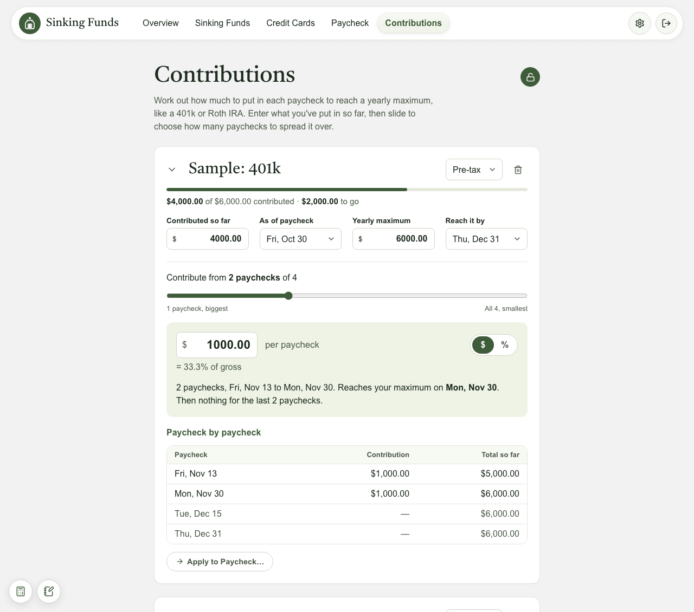

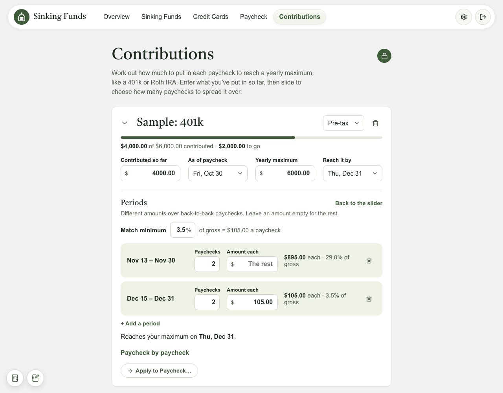

### Credit Cards
Each card's **Posted**, **Pending** and **Covered** amounts and the resulting balance. Click a Pending or Covered amount to list its individual transactions. **Cards vs bucket** compares the total owed with the money set aside for the cards (the bucket), and tells you how much to move or how much is spare. Locked by default, like Paycheck.

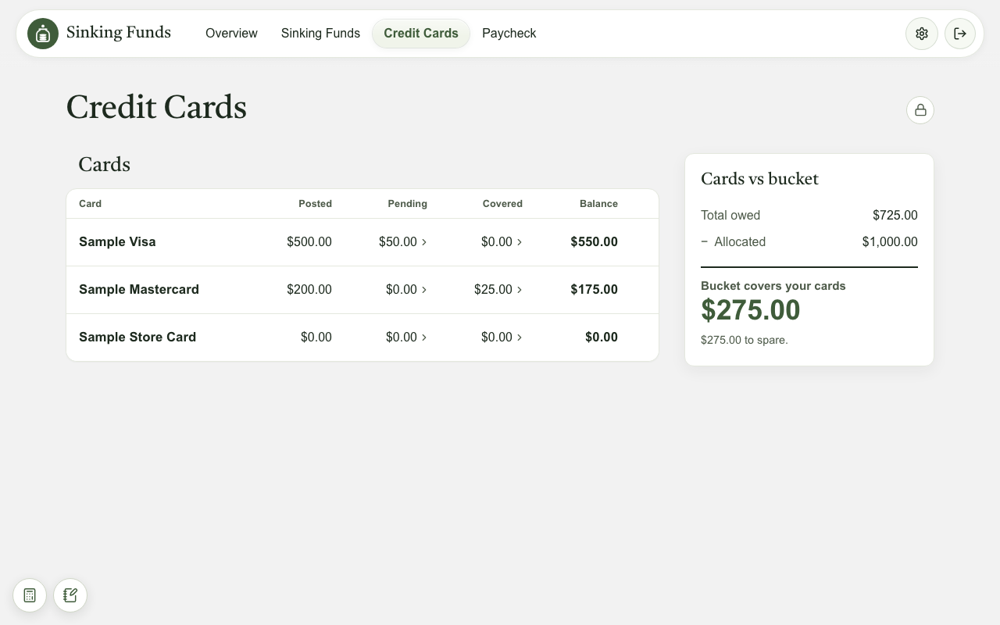

### Settings
The gear icon in the nav opens a page listing every rule the math uses: the pay schedule, how plans are calculated, and the Paycheck and Credit Card formulas. It also shows the next few paydays, including any that moved off a weekend. It's read-only for now; [TODO.md](TODO.md) lists what could become editable.

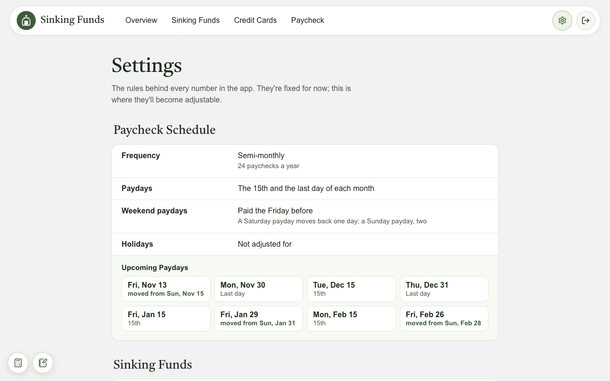

### Calculator and notes
The two buttons in the bottom-left corner open a calculator and a notepad that saves as you type. Both can be open at once, on any page.

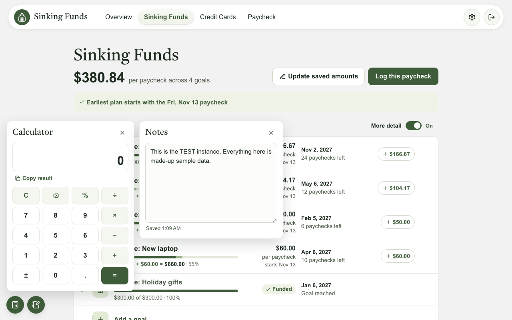

### Login
Single user, with the username and password set up the first time you run `./start_app.sh`.

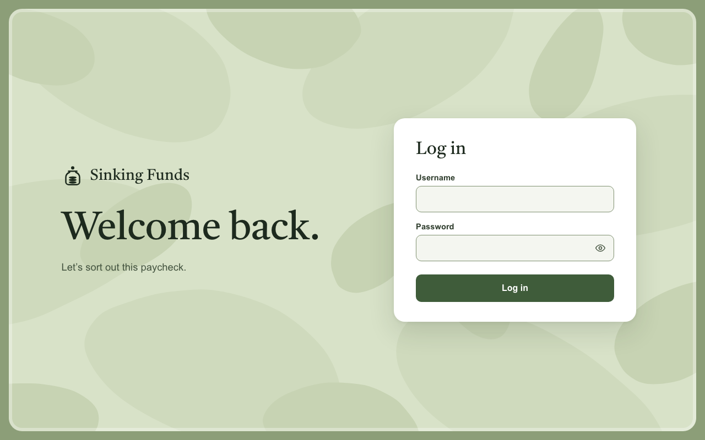

## How the math works

- **Pay schedule:** semi-monthly, paid on the 15th and the last day of each month. A payday that falls on a weekend is paid the Friday before. Holidays aren't accounted for.
- **Per paycheck:** `(goal − saved) ÷ paydays left`, counting paydays from the goal's plan start through its due date.
- **Plan start:** each goal's first paycheck. Logging a paycheck moves it to the following payday. Editing a goal by hand keeps it.
- **Paycheck:** `Net Pay = Gross − Pre-Tax − Taxes`, then `Leftover = Net Pay − Post-Tax − budget categories`.
- **Credit cards:** `balance = posted + pending − covered`.

The pay schedule lives in [`src/paycheck/schedules/bimonthly.py`](src/paycheck/schedules/bimonthly.py). Adding another schedule means a new module there plus a branch in [`paycheck.py`](src/paycheck/paycheck.py).

## Running it

Built with Python 3.9, Node.js 22 and npm 10.

```bash
./start_app.sh
```

This starts the backend (`http://127.0.0.1:5001`) and the frontend (`http://localhost:3000`). It also creates a Python virtual environment and installs the dependencies. The first run asks you to choose a username and password, which it saves to a gitignored `.env` file. Press Ctrl+C to stop.

**Without a terminal (macOS):** run `./make_desktop_app.sh` once to put **Sinking Funds.app** on your Desktop. It shows what's running and starts, stops or opens the app or the test instance, and restores the backup. It also writes **Sinking Funds.command**, the same menu inside Terminal (or run `./menu.sh`). Run `./start_app.sh` once first to set up your login.

**Test instance:** `./start_test.sh` runs a separate copy at `http://localhost:3001` with obviously fake sample data. It has an orange nav and a "TEST DATA" badge, and never touches your real data, so it's safe to experiment in. Its login is set in the gitignored `test.env`.

```bash
./start_test.sh          # fresh sample data
./start_test.sh --keep   # keep the test data from last time
./start_test.sh --empty  # start with no data
```

**Manually:**

```bash
# Backend
cd src/paycheck
pip install -r requirements.txt
python flask-connector.py

# Frontend
cd web-app/app
npm install
npm start
```

## Your data

- Everything is stored in SQLite at `src/paycheck/sinkingFunds.db`. Tables are created automatically the first time they're needed.
- The app keeps **one** rolling backup, `src/paycheck/backups/sinkingFunds_latest.db`, which is overwritten on start, stop and log out.
- **Restore the backup** with `./restore_db.sh`, or **Restore backup…** in the desktop app. It checks the backup, stops the app, keeps your current data as `backups/sinkingFunds_before_restore.db`, and puts the backup in place. Restore *before* stopping the app normally, because every stop overwrites the backup with the current data.
- **Download a copy** on Overview exports everything as JSON, or your goals as CSV.

## Project structure

```
src/paycheck/
  flask-connector.py      API routes
  database.py             All SQL (raw sqlite3)
  paycheck.py             Picks the pay schedule
  schedules/bimonthly.py  Semi-monthly paydays and savings math
  auth.py                 Single-user login
  seed_demo_data.py       Fake data for the test instance
web-app/app/src/
  App.js                  Routes, nav, tools dock
  components/utils/api.js All calls to the backend
  components/whole-view/  One folder per page: Dashboard (Overview), Grid (Sinking Funds),
                          InfoPage (a goal), BudgetCategories (Paycheck), CreditCards,
                          Contributions, Settings, Login, Nav, Tools, plus SinkingFunds (shared parts)
```

## API

Every route except `/`, `/login` and `/session` requires being logged in.

| Area | Routes |
|---|---|
| Session | `POST /login`, `POST /logout`, `GET /session` |
| Goals | `GET /get_data`, `GET /get_category_info`, `POST /add_category`, `POST /update_field`, `DELETE /remove_category`, `POST /update_card_order` |
| Plans | `GET /saved_by_paycheck`, `POST /recalculate_all`, `GET /next_payday`, `GET /upcoming_paydays` |
| Spending | `GET /goal_spending?id=`, `POST /spend_from_goal`, `DELETE /goal_spending` |
| Credit cards | `GET /get_credit_cards`, `POST /add_credit_card`, `POST /update_credit_card_balance`, `POST /update_covered_sub_balances`, `POST /update_pending_sub_balances`, `POST /update_credit_card_order`, `DELETE /remove_credit_card` |
| Bucket | `GET /get_ally_bank_balance`, `POST /update_ally_bank_balance` |
| Paycheck | `GET /get_paycheck_settings`, `POST /update_paycheck_settings`; and for each of `budget_category`, `pre_tax_benefit`, `post_tax_contribution`, `post_tax_benefit`: `GET /get_*s`, `POST /add_*`, `POST /update_*`, `POST /update_*_order`, `DELETE /remove_*` |
| Notes | `GET /get_notes`, `POST /update_notes` |
| Contributions | `GET /contribution_plans`, `POST /add_contribution_plan`, `POST /update_contribution_plan`, `DELETE /remove_contribution_plan`, `GET /paydays?after=&through=` |
| Export | `GET /export` (JSON), `GET /export_goals.csv` |
